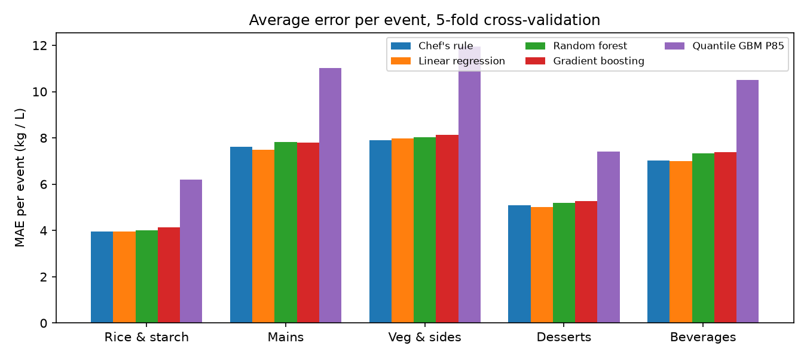
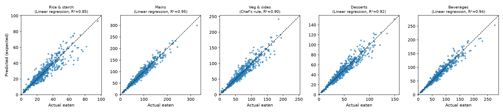
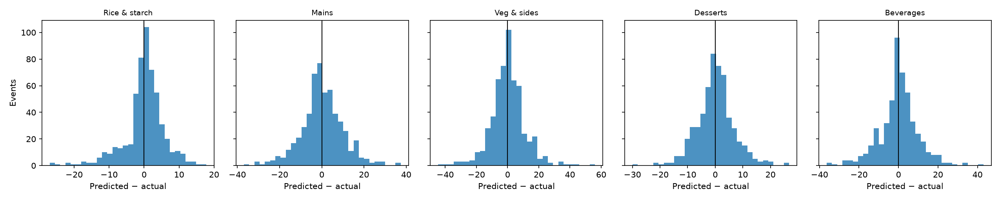
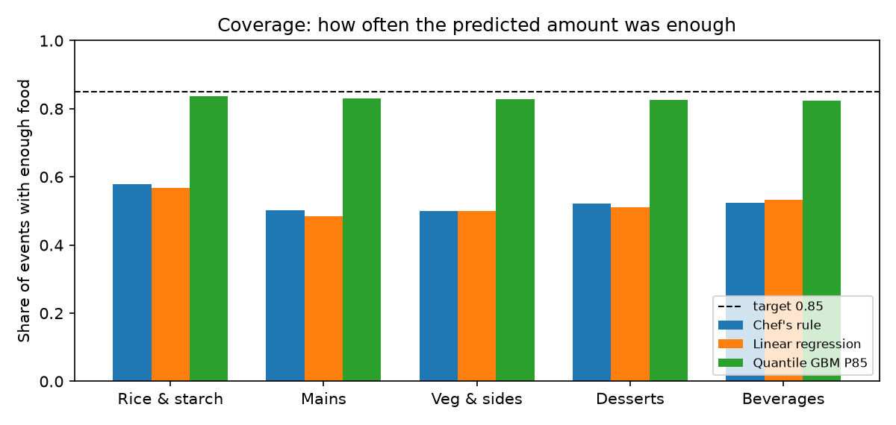
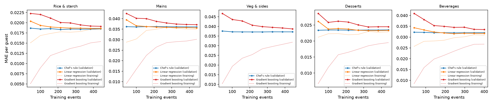
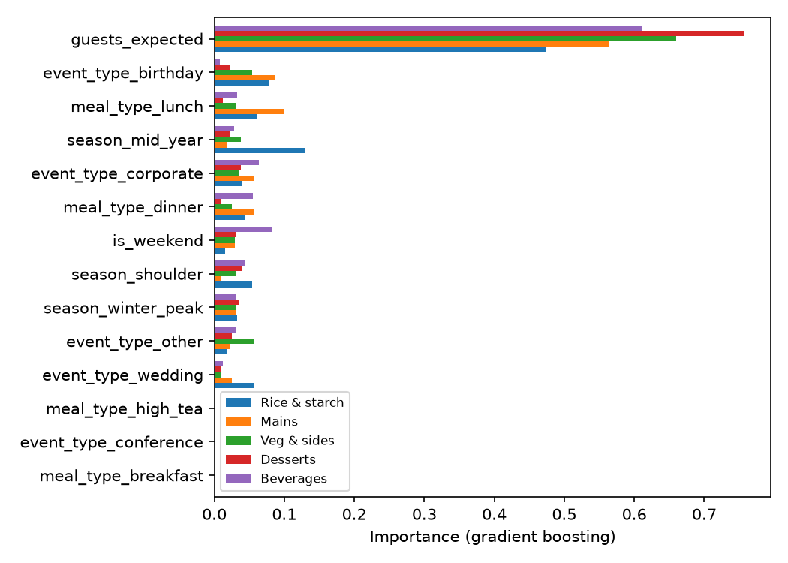
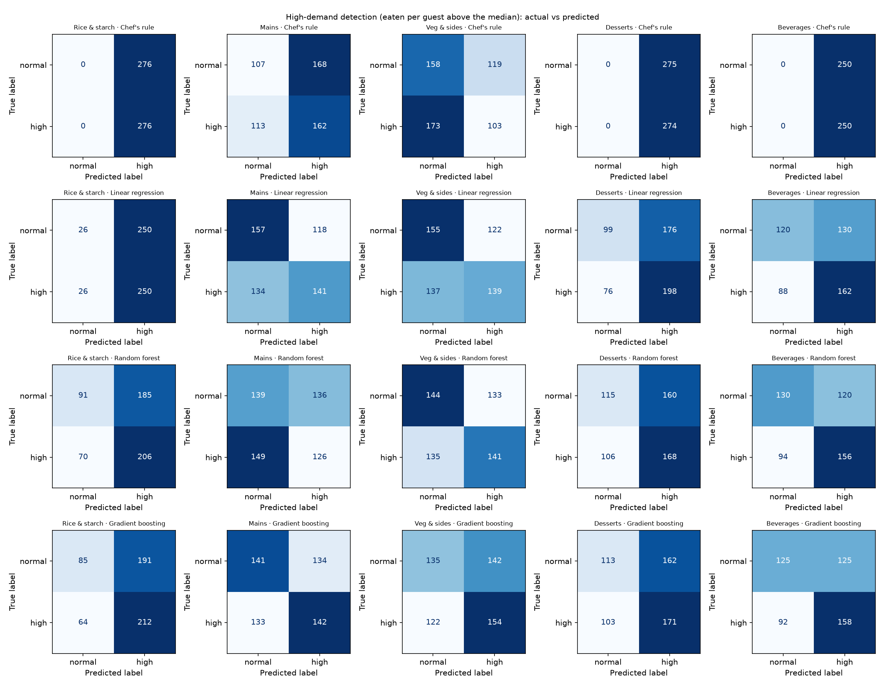
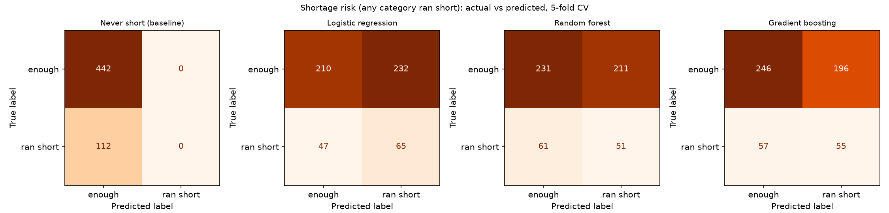
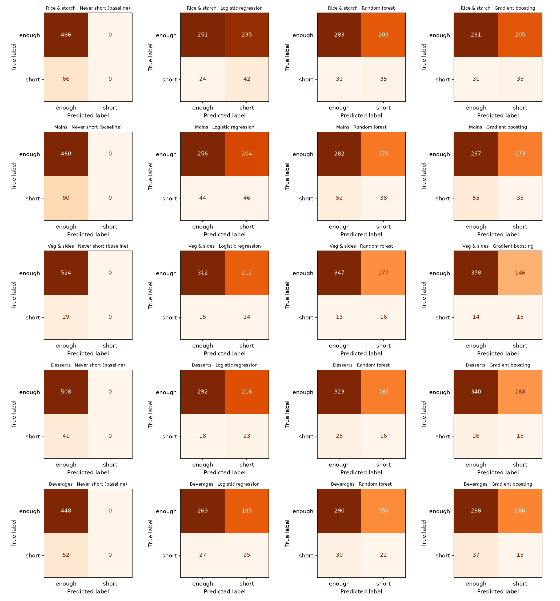
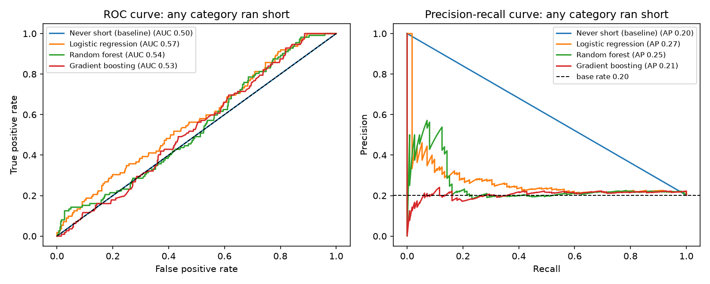

# Food Model Evaluation

Generated by `python src/evaluate.py` from `data/processed/master.csv`: 554 events.
Every number is out-of-fold from 5-fold cross-validation, so each event is scored by a model that
never saw it.

## Winners (used by the app, `models/winners.json`)
| category | expected | safe |
|---|---|---|
| rice_starch | Linear regression | Quantile GBM P85 |
| mains | Linear regression | Quantile GBM P85 |
| veg_sides | Chef's rule | Quantile GBM P85 |
| desserts | Linear regression | Quantile GBM P85 |
| beverages | Linear regression | Quantile GBM P85 |

The expected-quantity winner is the model with the lowest MAE in kg per category. The safe quantity
is the quantile GBM at P85.

## 1. Quantity models: all events
| category | model | n | mae_kg | rmse_kg | r2 | r2_per_guest | mape_pct | coverage |
|---|---|---|---|---|---|---|---|---|
| rice_starch | Chef's rule | 552 | 3.959 | 5.811 | 0.846 | -0.007 | 14.537 | 0.578 |
| rice_starch | Linear regression | 552 | 3.957 | 5.798 | 0.847 | -0.015 | 14.625 | 0.569 |
| rice_starch | Gradient boosting | 552 | 4.123 | 5.983 | 0.837 | -0.040 | 14.956 | 0.562 |
| rice_starch | Quantile GBM P85 | 552 | 6.204 | 8.055 | 0.705 | -0.867 | 24.511 | 0.837 |
| rice_starch | Random forest | 552 | 4.006 | 5.755 | 0.849 | -0.011 | 14.740 | 0.569 |
| mains | Chef's rule | 550 | 7.622 | 10.198 | 0.945 | -0.000 | 8.995 | 0.502 |
| mains | Linear regression | 550 | 7.485 | 10.060 | 0.947 | 0.023 | 8.878 | 0.484 |
| mains | Gradient boosting | 550 | 7.785 | 10.644 | 0.941 | -0.078 | 9.255 | 0.491 |
| mains | Quantile GBM P85 | 550 | 11.017 | 14.576 | 0.889 | -0.907 | 13.428 | 0.831 |
| mains | Random forest | 550 | 7.830 | 10.588 | 0.941 | -0.082 | 9.306 | 0.496 |
| veg_sides | Chef's rule | 553 | 7.894 | 11.079 | 0.902 | -0.006 | 12.213 | 0.499 |
| veg_sides | Linear regression | 553 | 7.964 | 11.165 | 0.900 | -0.028 | 12.347 | 0.501 |
| veg_sides | Gradient boosting | 553 | 8.128 | 11.334 | 0.897 | -0.081 | 12.757 | 0.508 |
| veg_sides | Quantile GBM P85 | 553 | 11.954 | 15.820 | 0.800 | -0.992 | 19.074 | 0.828 |
| veg_sides | Random forest | 553 | 8.027 | 11.149 | 0.901 | -0.032 | 12.598 | 0.494 |
| desserts | Chef's rule | 549 | 5.102 | 7.013 | 0.914 | -0.002 | 10.734 | 0.521 |
| desserts | Linear regression | 549 | 5.003 | 6.806 | 0.919 | 0.009 | 10.665 | 0.510 |
| desserts | Gradient boosting | 549 | 5.266 | 7.270 | 0.907 | -0.107 | 11.255 | 0.521 |
| desserts | Quantile GBM P85 | 549 | 7.413 | 9.850 | 0.830 | -1.061 | 17.012 | 0.825 |
| desserts | Random forest | 549 | 5.200 | 7.126 | 0.911 | -0.065 | 11.037 | 0.521 |
| beverages | Chef's rule | 500 | 7.024 | 9.976 | 0.937 | -0.004 | 8.895 | 0.524 |
| beverages | Linear regression | 500 | 7.006 | 9.838 | 0.939 | 0.019 | 8.794 | 0.532 |
| beverages | Gradient boosting | 500 | 7.383 | 10.601 | 0.929 | -0.078 | 9.266 | 0.532 |
| beverages | Quantile GBM P85 | 500 | 10.512 | 14.131 | 0.873 | -0.962 | 14.021 | 0.824 |
| beverages | Random forest | 500 | 7.340 | 10.339 | 0.932 | -0.069 | 9.267 | 0.540 |

`r2` is on kg per event, so it is high mostly because bigger events eat more. `r2_per_guest` is on
the target itself (eaten per guest) and shows how much the features add beyond the guest count.
`coverage` = share of events where the predicted amount was enough (target 0.85 for the P85 model).

## 2. High-demand detection (regression output as a yes/no call)
High demand = eaten per guest above the median for that category.
| target | model | n | positives | accuracy | precision | recall | f1 |
|---|---|---|---|---|---|---|---|
| rice_starch | Chef's rule | 552 | 276 | 0.500 | 0.500 | 1.000 | 0.667 |
| rice_starch | Linear regression | 552 | 276 | 0.500 | 0.500 | 0.906 | 0.644 |
| rice_starch | Random forest | 552 | 276 | 0.538 | 0.527 | 0.746 | 0.618 |
| rice_starch | Gradient boosting | 552 | 276 | 0.538 | 0.526 | 0.768 | 0.624 |
| mains | Chef's rule | 550 | 275 | 0.489 | 0.491 | 0.589 | 0.536 |
| mains | Linear regression | 550 | 275 | 0.542 | 0.544 | 0.513 | 0.528 |
| mains | Random forest | 550 | 275 | 0.482 | 0.481 | 0.458 | 0.469 |
| mains | Gradient boosting | 550 | 275 | 0.515 | 0.514 | 0.516 | 0.515 |
| veg_sides | Chef's rule | 553 | 276 | 0.472 | 0.464 | 0.373 | 0.414 |
| veg_sides | Linear regression | 553 | 276 | 0.532 | 0.533 | 0.504 | 0.518 |
| veg_sides | Random forest | 553 | 276 | 0.515 | 0.515 | 0.511 | 0.513 |
| veg_sides | Gradient boosting | 553 | 276 | 0.523 | 0.520 | 0.558 | 0.538 |
| desserts | Chef's rule | 549 | 274 | 0.499 | 0.499 | 1.000 | 0.666 |
| desserts | Linear regression | 549 | 274 | 0.541 | 0.529 | 0.723 | 0.611 |
| desserts | Random forest | 549 | 274 | 0.515 | 0.512 | 0.613 | 0.558 |
| desserts | Gradient boosting | 549 | 274 | 0.517 | 0.514 | 0.624 | 0.563 |
| beverages | Chef's rule | 500 | 250 | 0.500 | 0.500 | 1.000 | 0.667 |
| beverages | Linear regression | 500 | 250 | 0.564 | 0.555 | 0.648 | 0.598 |
| beverages | Random forest | 500 | 250 | 0.572 | 0.565 | 0.624 | 0.593 |
| beverages | Gradient boosting | 500 | 250 | 0.566 | 0.558 | 0.632 | 0.593 |

## 3. Shortage risk classification (will food run short?)
Booking-time features only. Positive class = ran short. Threshold 0.5, classes balanced in training.
| target | model | n | positives | accuracy | precision | recall | f1 | roc_auc | pr_auc |
|---|---|---|---|---|---|---|---|---|---|
| any | Never short (baseline) | 554 | 112 | 0.798 | 0.000 | 0.000 | 0.000 | 0.500 | 0.202 |
| any | Logistic regression | 554 | 112 | 0.496 | 0.219 | 0.580 | 0.318 | 0.572 | 0.271 |
| any | Random forest | 554 | 112 | 0.509 | 0.195 | 0.455 | 0.273 | 0.536 | 0.253 |
| any | Gradient boosting | 554 | 112 | 0.543 | 0.219 | 0.491 | 0.303 | 0.533 | 0.209 |
| rice_starch | Never short (baseline) | 552 | 66 | 0.880 | 0.000 | 0.000 | 0.000 | 0.500 | 0.120 |
| rice_starch | Logistic regression | 552 | 66 | 0.531 | 0.152 | 0.636 | 0.245 | 0.623 | 0.202 |
| rice_starch | Random forest | 552 | 66 | 0.576 | 0.147 | 0.530 | 0.230 | 0.605 | 0.201 |
| rice_starch | Gradient boosting | 552 | 66 | 0.572 | 0.146 | 0.530 | 0.229 | 0.599 | 0.170 |
| mains | Never short (baseline) | 550 | 90 | 0.836 | 0.000 | 0.000 | 0.000 | 0.500 | 0.164 |
| mains | Logistic regression | 550 | 90 | 0.549 | 0.184 | 0.511 | 0.271 | 0.573 | 0.229 |
| mains | Random forest | 550 | 90 | 0.582 | 0.176 | 0.422 | 0.248 | 0.566 | 0.230 |
| mains | Gradient boosting | 550 | 90 | 0.585 | 0.168 | 0.389 | 0.235 | 0.566 | 0.221 |
| veg_sides | Never short (baseline) | 553 | 29 | 0.948 | 0.000 | 0.000 | 0.000 | 0.500 | 0.052 |
| veg_sides | Logistic regression | 553 | 29 | 0.590 | 0.062 | 0.483 | 0.110 | 0.611 | 0.106 |
| veg_sides | Random forest | 553 | 29 | 0.656 | 0.083 | 0.552 | 0.144 | 0.621 | 0.089 |
| veg_sides | Gradient boosting | 553 | 29 | 0.711 | 0.093 | 0.517 | 0.158 | 0.667 | 0.099 |
| desserts | Never short (baseline) | 549 | 41 | 0.925 | 0.000 | 0.000 | 0.000 | 0.500 | 0.075 |
| desserts | Logistic regression | 549 | 41 | 0.574 | 0.096 | 0.561 | 0.164 | 0.600 | 0.105 |
| desserts | Random forest | 549 | 41 | 0.617 | 0.080 | 0.390 | 0.132 | 0.553 | 0.096 |
| desserts | Gradient boosting | 549 | 41 | 0.647 | 0.082 | 0.366 | 0.134 | 0.561 | 0.096 |
| beverages | Never short (baseline) | 500 | 52 | 0.896 | 0.000 | 0.000 | 0.000 | 0.500 | 0.104 |
| beverages | Logistic regression | 500 | 52 | 0.576 | 0.119 | 0.481 | 0.191 | 0.579 | 0.156 |
| beverages | Random forest | 500 | 52 | 0.624 | 0.122 | 0.423 | 0.190 | 0.547 | 0.142 |
| beverages | Gradient boosting | 500 | 52 | 0.606 | 0.086 | 0.288 | 0.132 | 0.513 | 0.129 |

## Reading the results
- `r2_per_guest` near 0 means the booking-time features explain little of how much each guest eats beyond the
  average. The chef's rule (average per guest) is hard to beat on plain error.
- The gain comes from the safe quantity: the P85 model reaches about 0.83 coverage and has the
  lowest shortage-weighted cost (see `python src/train.py` output).
- "Never short" gets high accuracy with zero recall: accuracy alone is misleading when shortages are
  rare, so compare models on recall, F1 and ROC-AUC.
